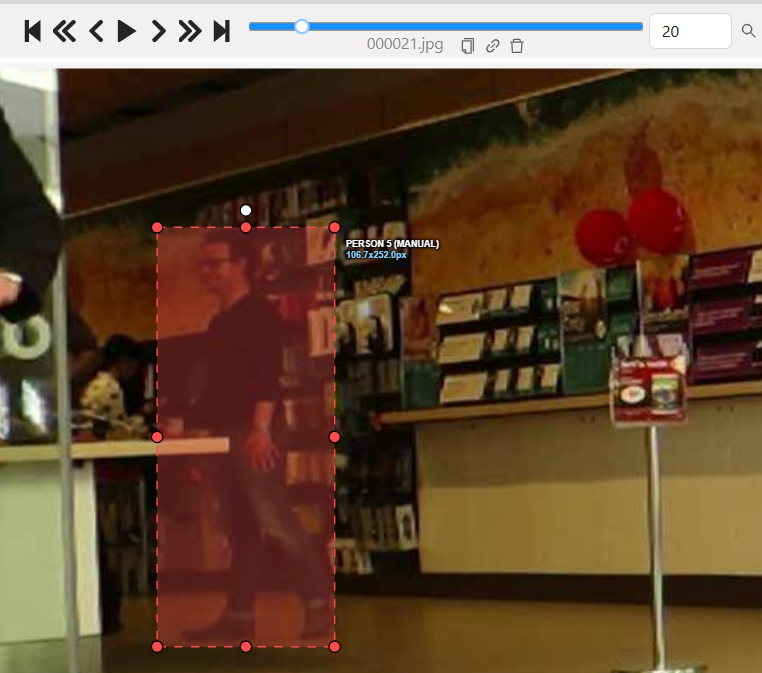
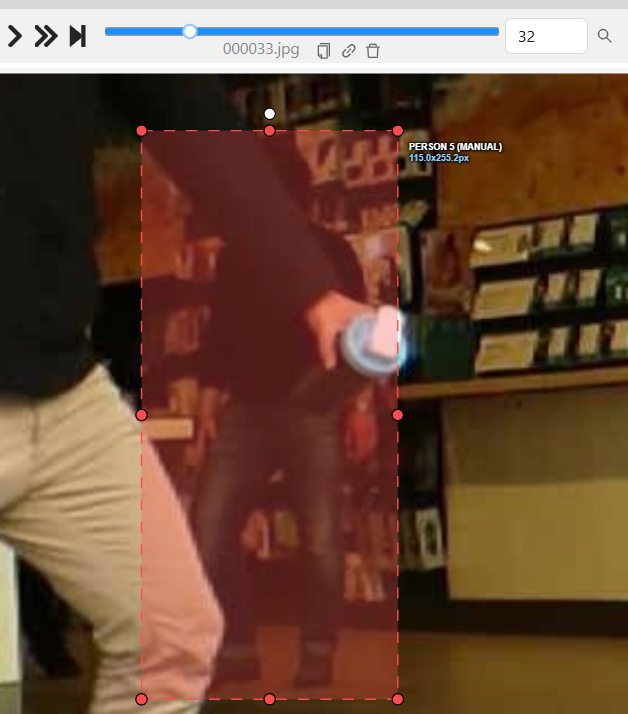
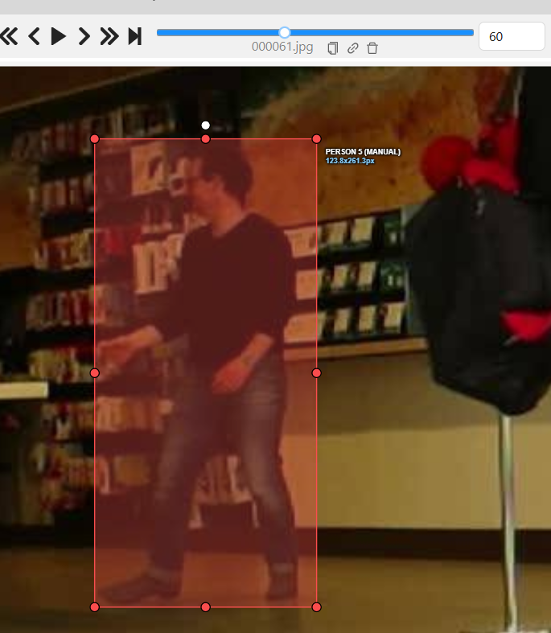

# Báo cáo cá nhân — PhamVanDuong-2A202603332

Đổi tên file theo quy tắc `MSSV_HoTen.md`. Ví dụ: `20241234_NguyenVanAn.md`.

Đoạn video: MOT17-09, 150 frame (frame 1–150), nguồn MOTChallenge, giấy phép CC BY-NC-SA 3.0.

## 0. Thông tin học viên

- Họ tên:Phạm Văn Dương
- MSSV:2A202603332
- Mã đề (A/B/C): B
- Email:26ai.duongpv@vinuni.edu.vn
- Link repository:https://github.com/pvd2201/K5-L2B-PhamVanDuong-2A202603332-MOTTracking
- Giờ bắt đầu: 17:00
- Giờ kết thúc: 18:30

## 1. Xem trước đoạn video (CP0)

Ghi **trước khi vẽ**, mỗi người một dòng.

| Mã | Frame xuất hiện | Frame cuối thấy được | Rẽ / dừng / đổi tốc độ ở frame | Bị che ở frame | Ghi chú |
|---|---|---|---|---|---|
| P1 |0 |149 |không |không| |
| P2 |0 |149 | không| 0| |
| P3 | 0|147 |27 |105 | |
| P4 | 0| 105|26 | 89| |
| P5 |0 |149 |23 | 0| |

## 2. Keyframe và thời gian (CP1, CP4)

Số keyframe lấy từ kết quả `src/check_submission.py`.

| Mã | Số keyframe | Keyframe ở frame | Số frame có mặt | Keyframe / 100 frame | Thời gian (phút) | Chỗ khó |
|---|---:|---|---:|---:|---:|---|
| P1 | 26 | [0, 31, 40, 44, 52, 70, 75, 76, 88, 90, 98, 106, 108, 111, 118, 126, 127, 130, 132, 133, 135, 137, 140, 142, 145, 149] | 150 | 17.3 | 15 | Không |
| P2 | 17 | [0, 3, 8, 21, 26, 35, 46, 47, 72, 79, 90, 91, 110, 118, 122, 135, 149] | 150 | 11.3 | 15|nhân vật bị outside |
| P3 | 27 | [0, 13, 28, 30, 35, 59, 73, 95, 104, 105, 106, 107, 108, 111, 135, 136, 137, 138, 139, 140, 141, 142, 143, 144, 146, 147, 149] | 150 | 18.0 | 15| Bị che khuất (45 frame occluded) |
| P4 | 22 | [0, 13, 17, 21, 27, 30, 35, 42, 81, 89, 95, 96, 98, 100, 101, 102, 103, 104, 105, 106, 107, 110] | 150 | 14.7 | 15| Bị che khuất (61 frame occluded) |
| P5 | 22 | [0, 20, 35, 55, 60, 66, 75, 86, 96, 98, 99, 106, 107, 108, 109, 111, 112, 116, 126, 134, 144, 149] | 150 | 14.7 |15 | Bị che khuất (69 frame occluded) |
| **Tổng** | **114** | — | **750** | **15.2** |90 | |

Keyframe / 100 frame của cả bài = tổng keyframe ÷ tổng số frame có mặt × 100  = 114 ÷ 750 × 100 = **15.2 keyframe/100 frame*

Bạn đặt keyframe nhiều nhất ở người nào? Vì sao (người đó rẽ, dừng, lại gần camera hay bị che)?

Tôi đặt keyframe nhiều nhất ở P3 với 27 keyframe. Nguyên nhân là do P3 có 45 frame được đánh dấu Occluded, khiến việc theo dõi và điều chỉnh bounding box khó khăn hơn. Do đó, tôi cần đặt thêm keyframe để đảm bảo bounding box bám sát đối tượng.
...

## 3. Đoạn bị che (CP2)

Người bị che: `P5`

| Mốc | Frame |
|---|---:|
| Bắt đầu bị che một phần (bật `occluded`) | 25 |
| Mất hẳn (bật `outside`) | Không có |
| Hiện lại (tắt `outside`) | Không có |
| Thấy rõ trở lại (tắt `occluded`) | 55 |

- Thời gian khuất hẳn: 2 frame.
- Quyết định: Giữ cùng ID.
- Lý do: P5 bị khuất hoàn toàn bởi một vật thể khác, nhưng vẫn có trong khung hình, không bị đi ra khỏi khung hình.
...

Ảnh chụp màn hình:





## 4. Tự review ID (CP3)

Lượt 1 theo người (đi ngược từ frame 149 về 0 trên CVAT), lượt 2 theo cảnh (nhảy 10 frame). Ít nhất 3 dòng; không có lỗi thì ghi một dòng "đã kiểm hai lượt, không lỗi".

Loại lỗi dùng đúng một trong 7 mã: `id_switch`, `fragmentation`, `lost`, `merge`, `false_track`, `drift`, `flag`.

| Frame | Mã người | Loại lỗi | Mô tả một câu | Phát hiện ở lượt | Đã sửa? |
|---:|---|---|---|---|---|
|       Đã kiểm hai lượt, không lỗi | | | | | |
| | | | | | |
| | | | | | |

Tổng hợp số lỗi theo loại:

| `id_switch` | `fragmentation` | `lost` | `merge` | `false_track` | `drift` | `flag` |
|---:|---:|---:|---:|---:|---:|---:|
| 0|0 |0 |0 |0 |0 |0 |

Lỗi nào chỉ lượt 2 (theo cảnh) mới thấy, lượt 1 (theo người) không thấy? Vì sao?

Không tìm thấy lỗi
...

## 5. File xuất và kết quả tự kiểm (CP4)

| Kiểm tra | Kết quả |
|---|---|
| Tên file MOT 1.1 | PhamVanDuong_mot.zip|
| Tên file CVAT for video 1.1 |PhamVanDuong_cvat_video.zip |
| Số track ID khác nhau trong `gt/gt.txt` (phải là 5) | 5|
| Frame `outside` không có dòng trong `gt.txt` (đúng / sai) |đúng |
| Job đã completed trên CVAT máy cá nhân |có |

Dán phần tóm tắt in ra từ `src/check_submission.py`:

```Số frame in theo CVAT (bắt đầu từ 0). Trong gt.txt, frame_id = frame CVAT + 1.

=== File CVAT for video 1.1: PhamVanDuong_cvat_video.zip ===

  Track | Nhãn   | Frame thấy | Keyframe | KF/100 frame | Frame occluded | Lần bật outside
      0 | person |        150 |       26 |         17.3 |              0 |               0
              Track 0: keyframe ở frame [0, 31, 40, 44, 52, 70, 75, 76, 88, 90, 98, 106, 108, 111, 118, 126, 127, 130, 132, 133, 135, 137, 140, 142, 145, 149]
      1 | person |        150 |       17 |         11.3 |              0 |               0
              Track 1: keyframe ở frame [0, 3, 8, 21, 26, 35, 46, 47, 72, 79, 90, 91, 110, 118, 122, 135, 149]
      2 | person |        150 |       27 |         18.0 |             45 |               0
              Track 2: keyframe ở frame [0, 13, 28, 30, 35, 59, 73, 95, 104, 105, 106, 107, 108, 111, 135, 136, 137, 138, 139, 140, 141, 142, 143, 144, 146, 147, 149]
      3 | person |        150 |       22 |         14.7 |             61 |               0
              Track 3: keyframe ở frame [0, 13, 17, 21, 27, 30, 35, 42, 81, 89, 95, 96, 98, 100, 101, 102, 103, 104, 105, 106, 107, 110]
      4 | person |        150 |       22 |         14.7 |             69 |               0
              Track 4: keyframe ở frame [0, 20, 35, 55, 60, 66, 75, 86, 96, 98, 99, 106, 107, 108, 109, 111, 112, 116, 126, 134, 144, 149]

  Tổng: 114 keyframe / 750 frame có mặt = 15.2 keyframe / 100 frame
  [OK]        Đọc được 5 track từ annotations.xml.

=== Tóm tắt ===
  Lỗi: 0   |   Cảnh báo: 0
  Đạt. Dán phần tóm tắt này vào báo cáo mục 5.
...
```

## 6. Ba câu kết

1. Nếu được gán lại, bạn sẽ đặt keyframe khác ở đâu? Vì sao?

   Nếu được gán lại, tôi sẽ bổ sung keyframe tại những khoảng thời gian có khoảng cách lớn giữa hai keyframe liên tiếp, ví dụ P5 ở khoảng frame 23–42.Lý do là khi khoảng cách giữa hai keyframe quá lớn, CVAT phải nội suy bounding box qua nhiều frame trung gian. Trong khi đó, người có thể di chuyển, đổi hướng hoặc thay đổi kích thước bounding box trong quá trình di chuyển.

2. Có chỗ nào bạn không chắc "cùng ID hay ID mới"? Bạn đã quyết định và ghi chú thế nào?

   Có một trường hợp cần cân nhắc về việc duy trì ID tại P5, trong khoảng frame 42-45, khi đối tượng bị che khuất hoàn toàn. Tôi đã quyết định hỏi labcoach và chốt phương án: gán occluded

3. Một lỗi ID trong job của bạn (nếu không còn sót, chọn lỗi đã sửa) có thể làm xe tự lái dự đoán sai chuyển động của người đó như thế nào? Lỗi đó ảnh hưởng MOTA hay IDF1 nhiều hơn?

   Một lỗi `id_switch` có thể khiến xe tự lái nhầm một người đi bộ đã được theo dõi trước đó thành một người mới khi người đó xuất hiện trở lại sau khi bị che khuất. Điều này làm gián đoạn quá trình theo dõi và có thể khiến hệ thống dự đoán sai quỹ đạo chuyển động, ảnh hưởng đến quyết định phanh hoặc tránh va chạm. Lỗi này ảnh hưởng đến cả MOTA và IDF1, nhưng IDF1 thường bị ảnh hưởng nhiều hơn vì chỉ số này tập trung đánh giá khả năng duy trì danh tính đối tượng qua các frame.

## Bonus (nếu làm)

### B1 — Hai người đi sát

...

### B2 — So cách đặt keyframe

| Cách đặt | Số keyframe | Frame trôi nhất | Ghi chú |
|---|---:|---:|---|
| Đều mỗi 30 frame | | | |
| Theo chỗ đổi hướng | | | |

...

### B3 — So với tracker có sẵn

| Frame | Mã người | Tracker làm gì | Nhãn của bạn | Giải thích (đoán rồi sửa / ghép IoU / box score thấp / ngoại hình) |
|---:|---|---|---|---|
| | | | | |
| | | | | |

## 7. Tài liệu tham khảo và công cụ AI đã dùng

...
